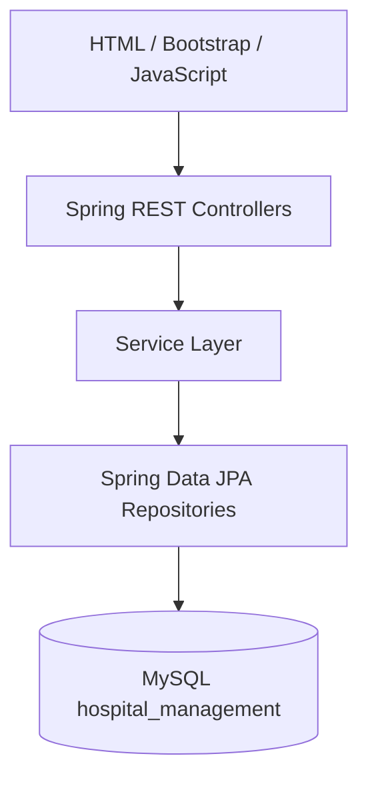
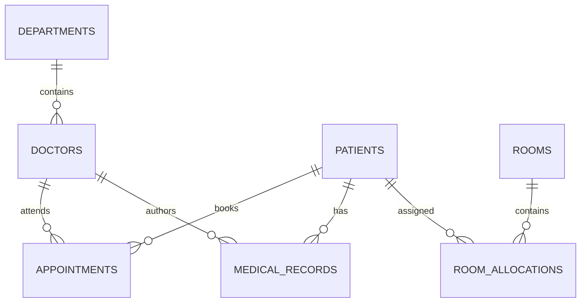
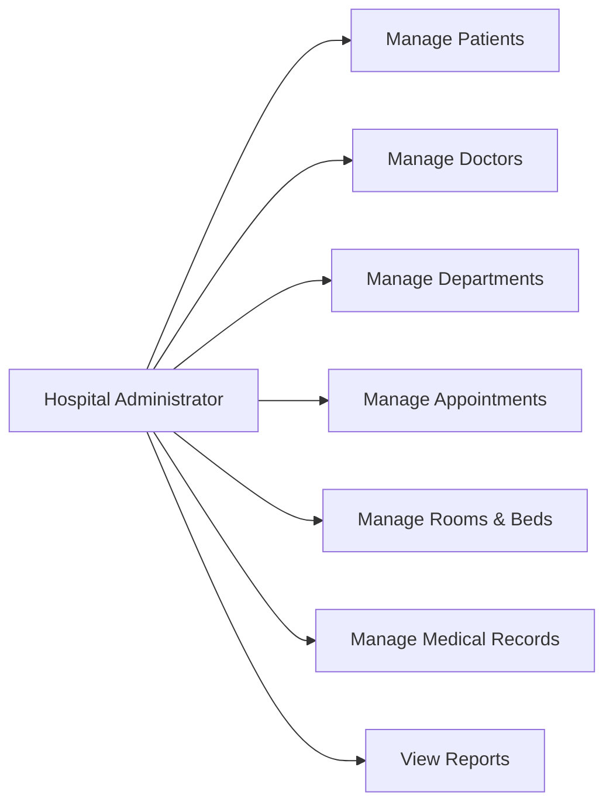
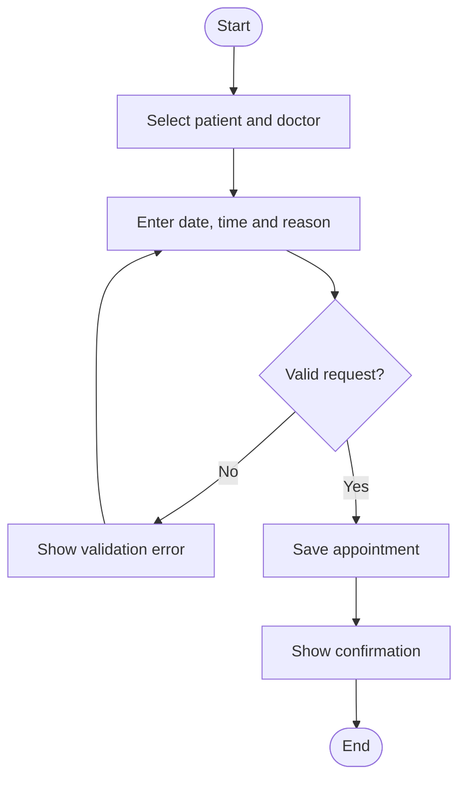

# Architecture & Diagrams

## Logical architecture

## Data model (planned relational associations)

**Current scaffold note:** the current entity classes store relationship IDs as integer fields to keep the generic admin UI and APIs easy to test. The ER relationships above are the target design and must be converted to entity associations/foreign-key constraints before production-like use.

## Use case overview

## Appointment activity flow

